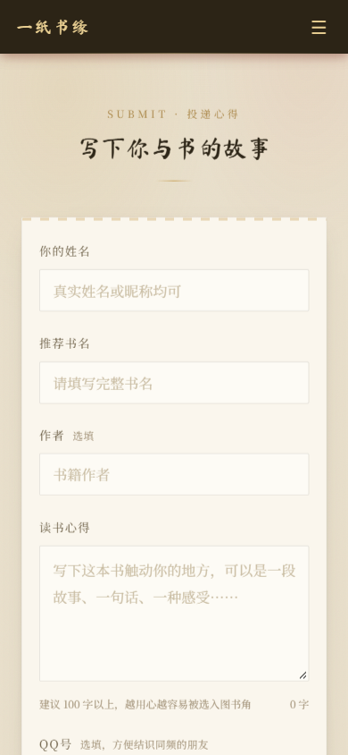
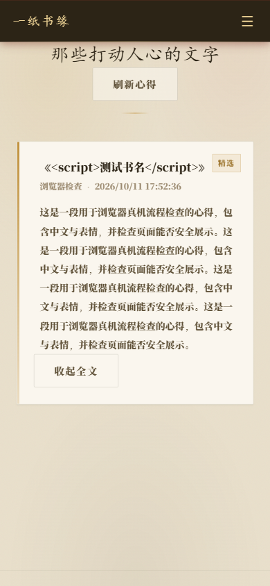
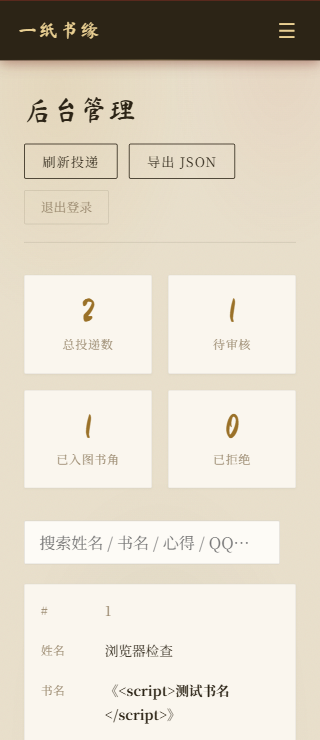

# 一纸书缘

[](https://github.com/toletetahiba719-cloud/yizhishuyuan/actions/workflows/ci.yml)


**写下你与一本书的故事，让书中的光照见同频的人。**

## 项目简介

一纸书缘是面向校园社团读书活动的轻量网站。参与者无需注册，便可投递阅读心得、浏览精选书评，或随机拆开另一位书友的来信。管理员先审核再公开，让活动内容能够统一管理，也让不同时间参加的同学共享同一份书香记忆。

项目采用 **Node.js 原生 HTTP 后端 + HTML/CSS/JavaScript 前端**，没有第三方运行依赖。页面以宣纸、墨色和信封为视觉主题，适配手机与桌面。面向约 300 人在数天至数周内分批参与的活动，部署后可以通过 HTTPS 链接或微信扫码访问。

> 当前提供可运行源码与部署工具，尚未部署正式活动站点。公开 GitHub 仓库不等于活动网站已上线。

## 功能模块

| 模块 | 使用者 | 主要功能 |
|---|---|---|
| 活动首页 | 所有访客 | 展示活动主题、参与方式与页面导航，支持分享链接直达功能页 |
| 心得信箱 | 参与者 | 填写昵称/姓名、书名、选填作者、20–2000 字心得及选填 QQ；提交校验、防重复、失败保留表单 |
| 随机拆信 | 参与者 | 随机抽取已审核心得，以信封动画展开全文，尽量避免连续抽到同一封，支持复制作者自愿公开的 QQ |
| 图书角 | 所有访客 | 卡片展示已审核的书籍与心得，手机端可展开全文，支持手动刷新与定时同步 |
| 审核后台 | 管理员 | 登录、统计、关键词搜索、阅读完整投稿、通过/拒绝/重置、删除、JSON 导出与退出登录 |
| 多人共享与安全 | 服务端 | 统一保存、审核过滤、Bearer 会话鉴权、登录限流、JSON 与同源校验；敏感文件不通过网页路由提供 |
| 部署与备份 | 维护者 | Ubuntu 安装脚本、systemd 常驻与重启、nginx HTTPS、每日备份及恢复说明 |

内容流转：**投递 → 待审核 → 管理员通过 → 图书角与拆信池公开**。拒绝、重置或删除后，该内容不再出现在后续公开接口响应中；已经被他人阅读、复制或下载的内容无法远程撤回。

昵称、书名和心得会在审核后公开。QQ 不属于私密信息：填写后会随已审核信件进入公开拆信池，可以留空。普通访客不能查看待审核记录，也不能下载完整管理数据。

## 页面预览

以下为测试内容的手机尺寸截图：

| 心得投递 | 图书角 | 审核后台 |
|---|---|---|
|  |  |  |

详细接口、字段与错误码见 [API 说明](docs/api.md)，本轮修复见 [更新记录](CHANGELOG.md)。

## 本地运行

推荐 **Node.js 24 LTS**，CI 验证 Node.js 22 / 24。

```bash
git clone https://github.com/toletetahiba719-cloud/yizhishuyuan.git
cd yizhishuyuan
npm ci --ignore-scripts
npm start
```

浏览器打开 [http://127.0.0.1:8080](http://127.0.0.1:8080)。首次运行会自动建立 `data/notes.json`。本地默认管理员密码为 `admin888`，仅供回环地址上的开发使用。生产环境或对外监听时，必须使用至少 16 位的独立随机密码，演示密码、示例占位密码与空白密码会被拒绝。正式安装脚本会自动生成密码。

自定义配置（Node.js 22/24 支持）：

```bash
# Windows PowerShell
Copy-Item .env.example .env
# macOS / Linux
cp .env.example .env

# 在 .env 中填写独立随机 ADMIN_PASSWORD 后运行；不要将密码提交到 GitHub
node --env-file=.env server.js
```

`npm start` 不自动读取 `.env`。直接双击 `index.html` 仅为本地演示，浏览器数据不能共享。

## 测试

```bash
npm test
```

测试自动使用临时目录，包含完整投递审核流程、中文分包、并发去重、会话撤销、同源/代理校验、敏感路径隔离、存储失败、恢复和负载测试，不会修改活动数据。GitHub Actions 在 Linux / Windows、Node.js 22 / 24 下执行相同测试。更多验证结果见 [检查报告](docs/check-report.md)。

运行中的站点可做只读自检：

```bash
node smoke-test.js http://127.0.0.1:8080
```

## 公网部署

推荐一台 **2 核 2GB、Ubuntu 24.04、有公网 IP 的轻量服务器**和自有域名。公网通过 nginx 的 80/443 访问，Node 默认只监听回环。大陆节点按服务商要求办理备案；香港节点需要实测校园网络。上线后必须做微信扫码真机验证。

完整购买、Windows 上传、安装、HTTPS、二维码与备份步骤：[部署与运维教程](docs/deployment.md)。

**GitHub Pages 只能托管静态页面，无法运行这个 Node 后端，也无法共享持久数据。** 正式活动不要只发布 `index.html`。

## 目录

```text
.
├── index.html             # 前端页面与交互
├── server.js              # HTTP API、审核、鉴权与持久化
├── backup.js              # JSON 校验与每日备份
├── setup.sh               # Ubuntu 安装、systemd 与备份定时器
├── setup-https.sh         # nginx 与免费 HTTPS 证书
├── integration-test.js    # 后端完整流程与负载测试
├── frontend-test.js       # 前端交互回归测试
├── smoke-test.js           # 已运行站点的只读自检
├── loadtest.js             # 负载测试工具
├── .env.example           # 无真实密码的配置示例
├── .github/workflows/     # Linux / Windows 自动测试
├── CHANGELOG.md           # 版本与修复记录
├── docs/                  # API、部署、检查报告与手机截图
└── data/                  # 运行时自动建立，不纳入 Git
```

## 数据与维护

数据保存在 `data/notes.json`，上一版与每日备份也位于 `data/`。整个数据目录、密码文件和本机设置均被 Git 忽略。上线数据应额外备份到电脑或异地，GitHub 源码备份不能代替活动数据备份。

当前按**单服务器、单 Node 进程**设计，不支持多个进程共同写同一份 JSON。未来长期运营或扩容时，应迁移到数据库与分页。昵称、心得和选填 QQ 在审核后公开，活动管理员应负责审核及撤回请求。

当前功能不包含学生账号注册、微信授权登录、图片或附件上传、私信、邮件通知、用户自行编辑与撤回。二维码指向部署后的网页链接，项目无需接入微信小程序。

维护流程见 [CONTRIBUTING.md](CONTRIBUTING.md)，敏感问题处理见 [SECURITY.md](SECURITY.md)。本仓库公开供查看，暂未授予开源许可证，保留现有权利。
